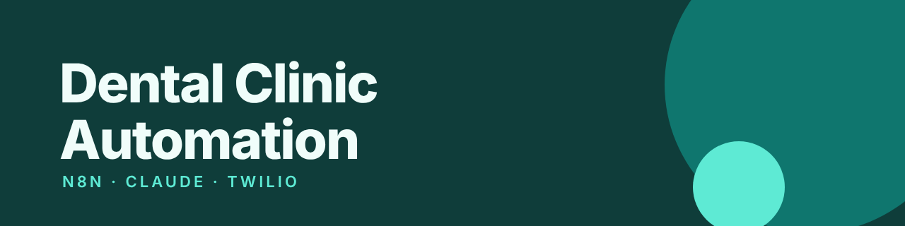
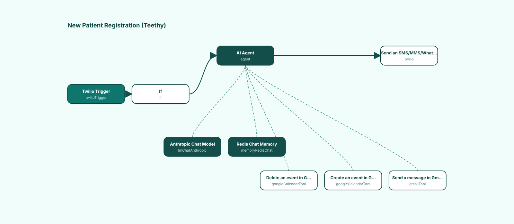
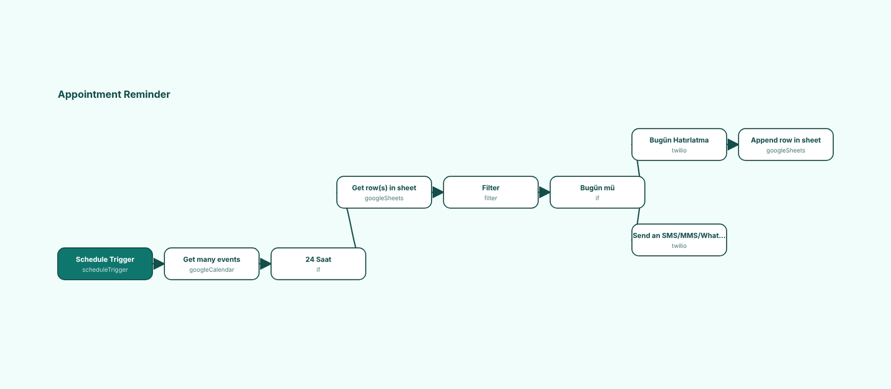
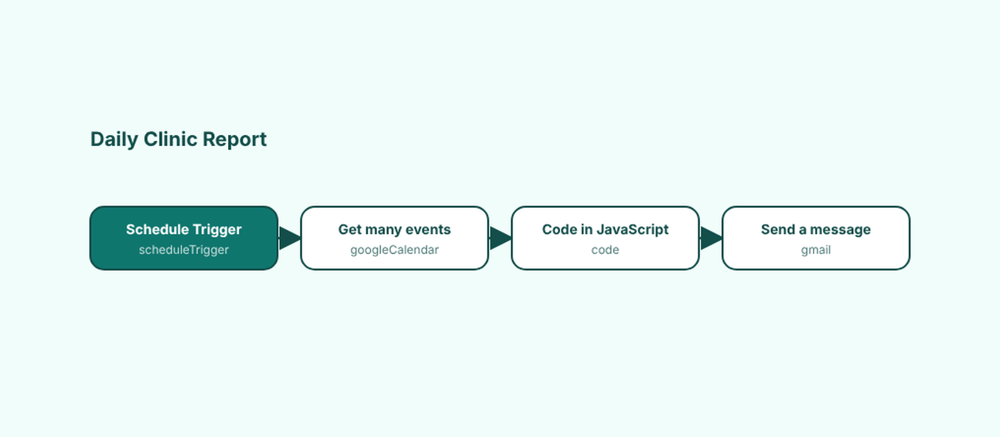
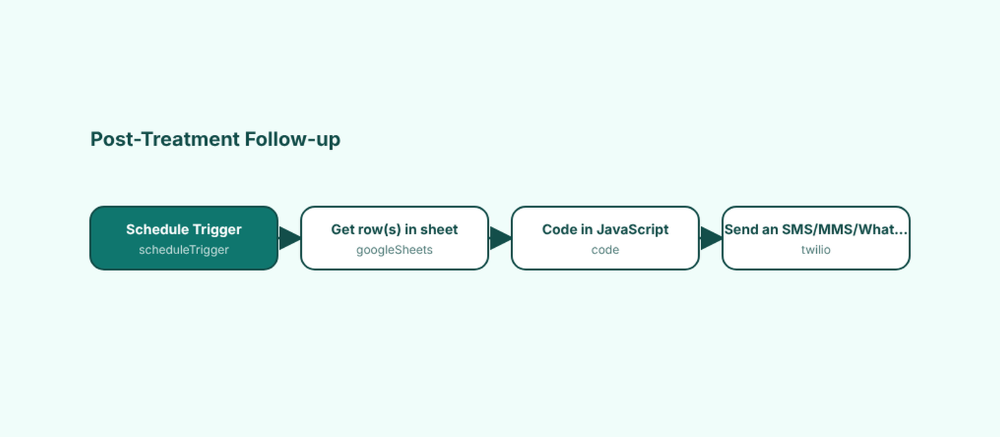
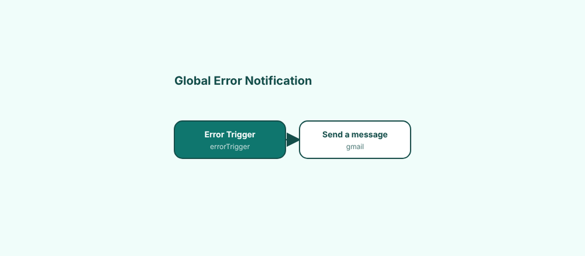

  

  <b>Dental Clinic Automation is a set of five n8n workflows that run a clinic's front desk.</b> An AI receptionist books appointments over WhatsApp/SMS, reminders and follow-ups go out automatically, and the manager gets a daily schedule by email. It is a working reference build, not a packaged product.

  
  
  
  
  
  
  
  

---

## Features

- **AI receptionist ("Teethy")** — Answers patient messages about symptoms, prices and hours via Claude, with Redis chat memory.
- **Calendar booking** — Creates and cancels appointments in Google Calendar and alerts the doctor by Gmail.
- **Appointment reminders** — A scheduled job sends 24-hour reminders and logs them in Google Sheets.
- **Daily clinic report** — Emails the next 24 hours of appointments each morning.
- **Post-treatment follow-up** — Sends check-in messages on days 1, 2 and 3 after a procedure.
- **Global error alerts** — Emails the workflow name and error message when any workflow fails.

## Screenshots

Diagrams rendered from the exported workflow JSON files (not screenshots of the n8n editor). Solid arrows are the main flow, dashed arrows are AI sub-connections.

  
  

  
  

  

## How It Works

A patient writes to the clinic's WhatsApp or SMS number. Twilio hands the message to the registration workflow, where a Claude agent with Redis memory answers questions and, when the patient agrees on a time, creates the event in Google Calendar and notifies the doctor. Each day a scheduled workflow reads the calendar, matches events to patient records in Google Sheets and sends reminders, while another emails the manager the day's schedule. After a treatment, a follow-up workflow compares dates in the sheet and sends the day 1, 2 and 3 messages. Any failure triggers the error workflow, which emails the details.

## Setup

1. Clone the repo and open your n8n instance.
2. Import the files in `workflows/` via **Add workflow → Import from File**.
3. Create your own credentials (Anthropic, Twilio, Google, Redis) and attach them to the nodes.
4. Point the Google Sheets and Calendar nodes at your own sheet and calendar, and set the error workflow in each workflow's settings.

## Limitations

- Built and tested as a reference; it has not been run in a live clinic.
- Patient data passes through Twilio, Anthropic and Google. Review privacy and consent rules (e.g. KVKK/GDPR) before real use.
- Credentials are not included and must be created by you.

## Contact

  
  
  

